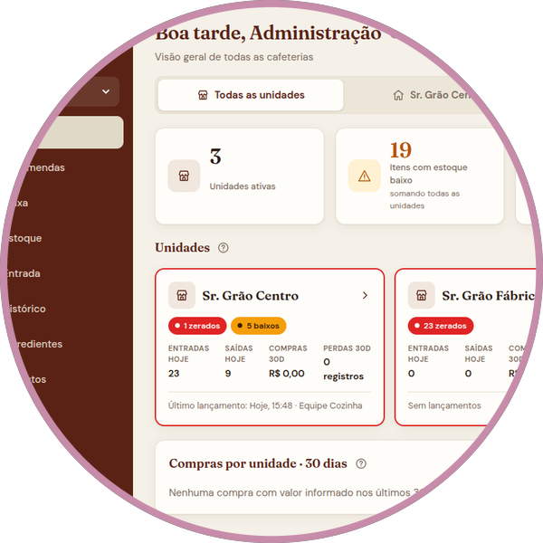
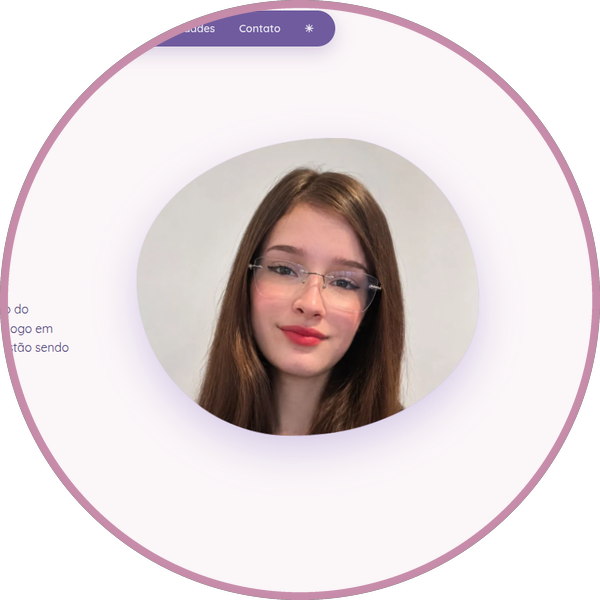

# Oi, eu sou a Lívia 🌸

**Desenvolvedora Full Stack Júnior · Landing Pages · Game Dev**

Todas as minhas experiências eu busquei por conta própria: conquistei clientes, entreguei projetos em produção e também desenvolvo jogos. Uso inteligência artificial no dia a dia para acelerar o desenvolvimento e organizar fluxos de trabalho.

🌐 **[Meu portfólio](https://foxylyv.github.io/portfolio/)** · 💼 [LinkedIn](https://www.linkedin.com/in/livia-souza-dev01001/) · ✉️ liviasouza311@gmail.com

 

## ✨ Projetos em destaque

<table align="center">
<tr>
<td align="center" width="33%" valign="top">

<h3>Estoque e Encomendas</h3>
Rede de cafeterias com 3 lojas + fábrica, entregue em produção. 
Django REST · JWT · React  
▶ <a href="https://foxylyv.github.io/sistema-estoque-encomendas/"><b>Demonstração</b></a> · <a href="https://github.com/Foxylyv/sistema-estoque-encomendas">código</a>
</td>
<td align="center" width="33%" valign="top">

<h3>Landing page de Seguros</h3>
Captação de clientes com cotação que abre direto no WhatsApp. 
HTML · CSS · JavaScript  
▶ <a href="https://foxylyv.github.io/landing-page-consultora/"><b>Abrir o site</b></a> · <a href="https://github.com/Foxylyv/landing-page-consultora">código</a>
</td>
<td align="center" width="33%" valign="top">

<h3>Meu portfólio</h3>
Meus projetos, jogos e artes digitais.  
HTML · CSS · JavaScript  
▶ <a href="https://foxylyv.github.io/portfolio/"><b>Abrir</b></a> · <a href="https://github.com/Foxylyv/portfolio">código</a>
</td>
</tr>
</table>

## 🛠️ Tecnologias

